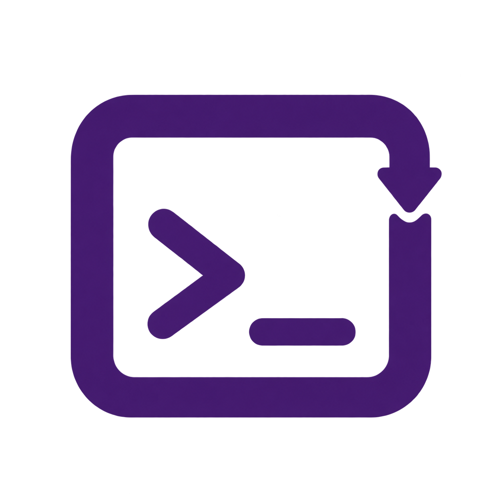
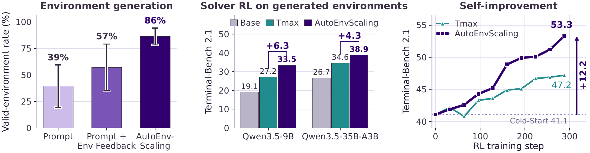
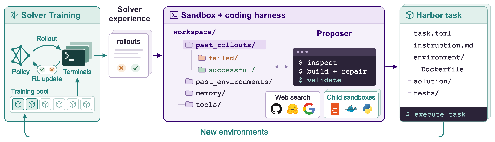

<p align="center">
  
</p>

<h1 align="center">AutoEnvScaling</h1>

<h3 align="center">Automating the Data Flywheel with Terminal Agents</h3>

<p align="center">
  <a href="https://msr-orchard.github.io/AutoEnvScaling/"><b>🌐 Project Page</b></a> &nbsp;|&nbsp;
  <b>📄 Paper</b> (arXiv link coming soon) &nbsp;|&nbsp;
  <a href="docs/experiments.md"><b>🧪 Reproducing the paper</b></a>
</p>

> [!NOTE]
> This repository is a private preview of the code release. Paths, commands, and defaults may
> change before the public release.

## Updates

* 29/09/2026: Private preview of the codebase: the proposer harness, host validation and
  calibration, proposer and solver rewards, the self-play loop, evaluation, and the scripts
  behind every figure and table in the paper.

## Introduction

Terminal agents solve tasks in software engineering and scientific research by executing
commands in a terminal. Training them with reinforcement learning needs diverse, verifiable
environments, and researchers still design most of them by hand, so their supply grows only as
fast as researchers can work.

**AutoEnvScaling** treats environment design as a terminal task. A proposer agent reads the
rollouts of the solver being trained, builds new environments as complete Harbor tasks inside a
sandbox, and tests them there. The host admits an environment only if it validates and suits the
current solver, and the solver's new rollouts guide the next round. Because building an
environment and solving one are both terminal tasks, one open-weight model can play both roles
and train on its own environments.

<p align="center"></p>

In the paper, the terminal harness raises the valid-environment rate of eight frontier proposers
by up to 25x over prompt-only generation. Environments from GPT-5.6-sol and Claude Opus 5 improve
Qwen3.5-9B and Qwen3.5-35B-A3B on Terminal-Bench 2.1 over static Tmax pools, and with
Qwen3.6-35B-A3B as both proposer and solver, Terminal-Bench 2.1 rises from 41.1 to 53.3.

## Architecture

<p align="center"></p>

| Stage | What happens | Code |
|---|---|---|
| Assignment | A parent environment from the pool, the solver's pass rate on it, and its most common failure. | `autoenvscaling/proposer/assignment.py` |
| Proposer episode | The proposer works in a sandbox (16 CPU, 32 GiB, 2 h) with a workspace of past rollouts, past environments, memory, and tools, through Claude Code, Codex, or Pi. It writes a Harbor task and can build and test it in child containers. | `autoenvscaling/proposer/`, `autoenvscaling/sandbox/`, `skills/`, `docker/proposer/` |
| Validation | The host builds the task; the reference solution must score 1 and an empty solution below 0.5; the instruction may not share a 13-gram with a held-out task; `harbor check` reviews the task against the Terminal-Bench rubric. | `autoenvscaling/validation/`, `rubrics/` |
| Calibration | The current solver attempts the task 4 times (8 near a band edge); it is kept if the mean reward is in [0.25, 0.75] and the rewards vary. Failed tasks go back to the proposer, up to 2 revisions. | `autoenvscaling/calibration/` |
| Rewards | Solver: fraction of tests passed. Proposer: -1 if validation fails, -0.25 if calibration fails, 1 if admitted. Advantages are centred per role. | `autoenvscaling/rewards.py` |
| Pool and self-play | Admitted tasks form the solver's pool, reviewed every 16 solver updates. In self-play, one policy trains as solver every step and as proposer every 16 steps. | `autoenvscaling/pool.py`, `autoenvscaling/pipeline.py`, `autoenvscaling/selfplay/` |
| Training | Miles (DPPO) with our patch; launchers and presets for every run in the paper. | `autoenvscaling/training/`, `third_party/miles/` |
| Evaluation | Terminal-Bench 2.1 and 4.0 (avg@5) and HiL-Bench, through Harbor. | `autoenvscaling/evals/` |

Sandboxes run on [Modal](https://modal.com) by default: the proposer sandbox through the Modal
SDK, and every Harbor trial (validation, calibration, evaluation) through Harbor's built-in Modal
environment. A local Docker backend is available for development.

## Installation

```bash
git clone git@github.com:MSR-Orchard/AutoEnvScaling.git && cd AutoEnvScaling
uv venv -p 3.12 && source .venv/bin/activate
uv pip install -e ".[dev]"          # add ".[analysis]" to regenerate the paper figures
modal token new                     # once, for the Modal sandbox backend
cp .env.example .env                # fill in the keys your run needs
```

Python 3.12 or newer is required (Harbor 0.23.0). Every setting defaults to the value used in the
paper; override it in a TOML file passed with `--config` or with `AES_*` environment variables
(see `autoenvscaling/config.py`).

## Quickstart

Check one Harbor task the way the host does before admitting it:

```bash
# validation only: build, reference solution, empty solution, contamination, rubric review
autoenvscaling admit path/to/task --no-calibrate

# full admission, including calibration against a solver endpoint (AES_SOLVER_* in .env)
autoenvscaling admit path/to/task
```

Seed a pool and run one round of environment generation with a frontier proposer:

```bash
autoenvscaling selfplay seed --pool-dir runs/pool path/to/seed/tasks/*
autoenvscaling selfplay generate --pool-dir runs/pool --out-dir runs/round0 \
    --harness claude-code --model claude-opus-5 --assignments 8 \
    --solver-base-url $AES_SOLVER_BASE_URL --solver-model $AES_SOLVER_MODEL
```

Each episode writes its Harbor task and the proposer trajectory with its admission reports and
reward r_P, and admits the task to the pool if it passes.

## Reproducing the Paper

Every table and figure maps to a launcher under `cmd/`; [`docs/experiments.md`](docs/experiments.md)
lists the exact settings, data, and outputs for each, and marks any step this preview cannot run
yet.

| Experiment | Paper | Launcher |
|---|---|---|
| Environment design with and without a terminal (Prompt, Prompt + Env Feedback, AutoEnvScaling; 8 proposers) | Section 4.1, Table 2, Figures 4-5 | `cmd/exp1_authoring/` |
| Solver RL on frontier-proposer curricula vs static Tmax pools (Qwen3.5-9B, Qwen3.5-35B-A3B; w/o solver feedback) | Section 4.2, Table 3 | `cmd/exp2_solver_rl/` |
| Self-play with Qwen3.6-35B-A3B in both roles (vs Tmax, vs no proposer training) | Section 4.3, Figures 6-7 | `cmd/exp3_self_play/` |
| Cold-Start fine-tuning on 600 proposer trajectories | Section 4.3, Appendix | `cmd/cold_start/` |
| HiL-Bench: learning to ask for help | Section 4.5 | `cmd/hilbench/` |
| Cross-domain environments (software engineering, computer use, professional work, GPU kernels) | Appendix | `cmd/cross_domain/` |
| Terminal-Bench 2.1 / 4.0 evaluation | Sections 4.2-4.3 | `cmd/evals/` |
| Paper figures and tables from released data | all | `analysis/` (reads `data/paper/`) |

## Repository Layout

```
autoenvscaling/   the package: proposer, sandbox, validation, calibration, rewards, pool,
                  pipeline, selfplay, training, evals, baselines, trajectories
skills/           the auto_env_scaling proposer skill and cross-domain references
docker/proposer/  the proposer image and the tools available inside the sandbox
rubrics/          the Terminal-Bench task-implementation rubric used by `harbor check`
third_party/      the Miles patch and the upstream commit it applies to
cmd/              one launcher per paper experiment
analysis/, data/  scripts and data behind the paper's figures and tables
tests/            unit tests (live tests need credentials: AES_LIVE_TESTS=1)
```

## Citation

```bibtex
@misc{yu2026autoenvscaling,
  title={AutoEnvScaling: Automating the Data Flywheel with Terminal Agents},
  author={Simon Yu and Baolin Peng and Bo Liu and Zhengyan Shi and Zhaoyang Wang and Hao Cheng and Qianhui Wu and Wenlin Yao and Natasha Jaques and Weiyan Shi and Jianfeng Gao},
  year={2026},
  note={arXiv preprint, to appear}
}
```

## Acknowledgement

* Environments are Harbor tasks, built, run, and reviewed with the
  [Harbor](https://github.com/harbor-framework/harbor) framework; the proposer follows Harbor's
  `create-task` skill.
* RL training uses [Miles](https://github.com/radixark/miles) with DPPO.
* Sandboxes run on [Modal](https://modal.com).
* The rubric review uses the [Terminal-Bench](https://github.com/harbor-framework/terminal-bench)
  task-implementation rubric, and the baseline pools follow Tmax.
* The shared-policy design builds on our earlier work, [SPADE](https://github.com/spade-rl/spade).

## License

AutoEnvScaling is released under the [Apache License 2.0](LICENSE). Third-party components
keep their own licences; see [`THIRD_PARTY_NOTICES.md`](THIRD_PARTY_NOTICES.md).
